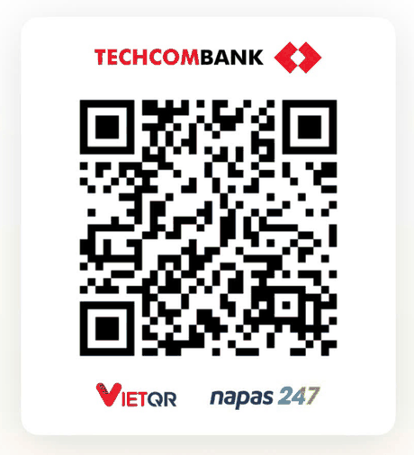

# Sales-Hunter

Khung phát triển cho hệ thống **săn sale và tạo nội dung affiliate đa nền tảng**, trước mắt nhắm tới Shopee và TikTok Shop.

**Platform:** subdomain của [Đồng Hành Cùng Bạn](https://www.donghanhcungban.org) — mục tiêu **`sales.donghanhcungban.org`** (xem [docs/PLATFORM.md](docs/PLATFORM.md), [ADR-0002](docs/adr/0002-platform-subdomain-dhcb.md)).

> Trạng thái: skeleton Phase 1–6 đã có trên base: publication candidate, manual observation + kill switch, approval + dry-run publisher, operator HTTP API, SQLite + Token Auth + Web Dashboard, analytics/recall và runbook. Chưa có client mạng thật, DNS/TLS, cutover hay publish không dry-run. Audit 25/09 ghi nhận các blocker cần sửa trước external deploy/publish thật; lưu báo cáo không đồng nghĩa đã sửa lỗi.

## Đánh giá và kế hoạch nâng cấp

[Báo cáo audit và bộ kiểm chứng ngày 25/09/2026](docs/audits/2026-09-25/README.md) gồm 27 hạng mục, mức ưu tiên và tiêu chí nghiệm thu; lộ trình ưu tiên dữ liệu đúng, phê duyệt đúng, đăng có kiểm soát và phục hồi được. Kiến trúc Django/PostgreSQL là đề xuất cần ADR/triển khai riêng, chưa phải runtime hiện tại. Xem [PROJECT-STATUS.md](PROJECT-STATUS.md) để tiếp tục đúng việc.

## Mục tiêu

```text
nguồn chính thức / adapter
  -> quan sát có bằng chứng
  -> chuẩn hóa + validate
  -> xếp hạng deterministic
  -> bản nháp + link affiliate
  -> người duyệt
  -> đăng kênh
  -> đo chuyển đổi
```

## Bắt đầu

Python 3.11+ và [uv](https://docs.astral.sh/uv/).

```bash
uv sync
$env:PYTHONPATH = "src" # PowerShell; POSIX: export PYTHONPATH=src
uv run python -m unittest discover -s tests -v
```

## Tài liệu

- [AGENTS.md](AGENTS.md) · [ARCHITECTURE.md](ARCHITECTURE.md) · [CODEMAP.md](CODEMAP.md)
- [ROADMAP](docs/ROADMAP.md) · [PHASES](docs/PHASES.md) · [PLATFORM](docs/PLATFORM.md)
- [Hợp đồng dữ liệu](docs/HOP-DONG-DU-LIEU.md)
- **[Quy ước subagent task](docs/SUBAGENT-TASK-CONVENTION.md)** — mọi phase/việc lớn: tách subtask + `model_tier` T0–T4 trước khi giao agent
- [Trạng thái thực thi](PROJECT-STATUS.md) — checkpoint chuẩn giữa các phiên
- [Audit chất lượng và vận hành 25/09/2026](docs/audits/2026-09-25/README.md)

## Ủng hộ và liên hệ

Dự án miễn phí và mở mã. Nếu nó giúp bạn tiết kiệm thời gian, bạn có thể ủng hộ để tác giả duy trì và phát triển tiếp:



- Quét mã VietQR bằng ứng dụng ngân hàng bất kỳ, hoặc chuyển khoản **Techcombank — số tài khoản `890977819110`**.
- Liên hệ, góp ý, hợp tác: điện thoại / Zalo **[+84 977 819 110](https://zalo.me/0977819110)** ·
  email **admin@donghanhcungban.org**. Lỗi và đề xuất tính năng xin mở issue trên GitHub.
- **Hỗ trợ triển khai:** tác giả hỗ trợ cài đặt và áp dụng dự án cho nhu cầu của bạn — **trực tiếp tại TP. Hồ Chí Minh**
  hoặc **online** ở bất kỳ đâu. Liên hệ qua điện thoại/Zalo hoặc email ở trên để trao đổi.

Ủng hộ là tự nguyện, không kèm quyền lợi riêng; hỗ trợ triển khai thoả thuận riêng theo từng dự án.

## Giấy phép

[Apache License 2.0](LICENSE).
